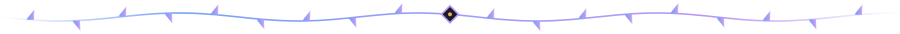
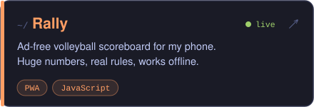
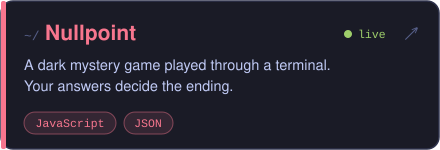
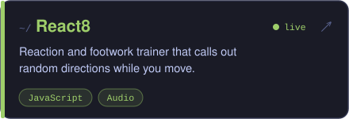
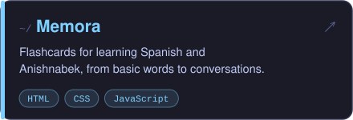
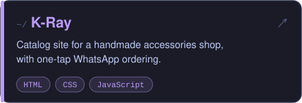
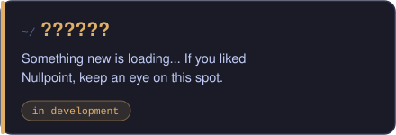

### `~/stack`

### `~/projects`

### `~/activity`

<picture>
  <source media="(prefers-color-scheme: dark)" srcset="https://raw.githubusercontent.com/alex-gamero/alex-gamero/output/snake-dark.svg" />
  <source media="(prefers-color-scheme: light)" srcset="https://raw.githubusercontent.com/alex-gamero/alex-gamero/output/snake-light.svg" />
  
</picture>

Ottawa 🍁 · always building something

